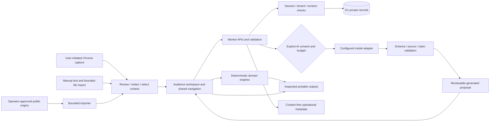
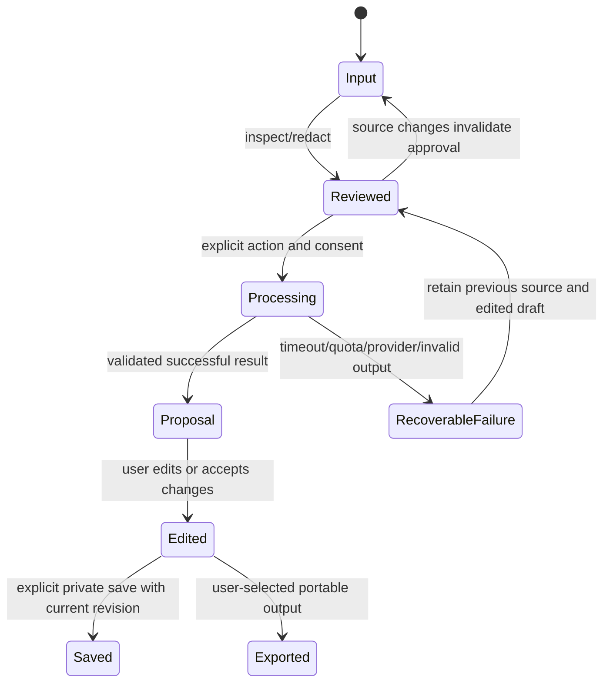

# Implementation plan after the 22 October product audit

Decision date: 23 October 2026. Owner instruction: implement the consolidated plan and deliver the complete useful web application. The earlier report-only boundary is superseded for implementation; the separate production-release approval rule remains.

## Architecture decision

Use a modular monolith on the current React/vinext application, Cloudflare Worker and D1 database. Keep existing project, source, time and capacity engines and their saved-record contracts. A rewrite would duplicate working behavior and risk existing records. More speculative architecture documents would delay verified repairs. This plan supplies the high-level boundaries, low-level contracts and release gates needed to implement safely; detailed decisions accompany the feature that needs them.

The private owner-review audit remains at `investigations/reports/audit-2026-10-22/`. Do not copy raw security reproductions, credentials or private profile material into the public repository. The public requirements register is the normalized scope baseline; proposed market additions are distinguished from the original brief. No numerical completion percentage is derived from grouped requirement counts.

## High-level design

Browser deterministic engines implement formulas, parsing, deduplication, graph/capacity calculations, formatting and exports. Worker APIs enforce authority, limits and private persistence. AI proposes analysis or edits from selected sources; it does not confer authorization, invent proof or silently change confirmed records. No public URL is treated as consent to crawl a private platform.

## Domain model and low-level rules

Keep project JSON versions readable. New features introduce compatible optional fields or additive tables, never destructive initialization of an existing database. Separate raw approved input, generated result and user-edited draft. Reuse stable references rather than copying private corpora into unrelated records.

| Record | Contract | Invariant |
| --- | --- | --- |
| Source revision | Owner, locator, capture method/time, coverage, reviewed text/hash and schema version | A locator is not verification. Redaction/removal invalidates retained quotes and dependent claims. |
| Review session | Goal, platform/page type, selected source revisions, criterion findings, limitations and actions | Missing fields are unknown; competitor statements cannot become the owner's achievements. |
| Draft revision | Original/generated/edited content and accepted changes | Failed attempts retain edited work; stale source changes cannot silently retain redacted facts. |
| Claim/support | User-approved wording, source span, assertion type, disclosure scope and withdrawal state | An exact quote proves correspondence, not truth or skill mastery. |
| Opportunity/application | Supplied brief, confirmed requirements, constraints, pipeline stage and exact submitted revision | No automatic messages or job applications; no fabricated conversion statistics. |
| Decision/approval | Objective, alternatives, constraints, current revision, actor and supersession | Approval belongs to an exact revision and must be revalidated before use. |
| Calendar scenario | Explicit dates/timezone, supplied availability/busy intervals and project references | A what-if scenario never writes to a real calendar or changes accepted scope. |
| Processing run | Engine/model/prompt/schema versions, bounded selected context, state and error code | No hidden inference retry, uncontrolled cost or arbitrary external side effect. |

API mutations derive the owner from the session, recheck active authority in the database mutation itself and use optimistic revisions. Validate streamed byte limits before parsing; validate references and cycles before persistence. Preserve private `no-store` responses. Public HTML/asset response policy must work with streamed framework output and exact-origin extension handoff.

State transitions:

## Delivery sequence and natural commit boundaries

Finish a coherent milestone, verify it, publish it promptly and review the exact pushed head before dependent work. Tests stay with behavior. Do not split trivial edits or manufacture issues for activity. A merged source milestone is not a production release.

| Stage | Outcome | Requirement/action links | Exit gate |
| --- | --- | --- | --- |
| R0 - trusted foundation | Commit-time session protection, safe importer boundary, supported dependency repair, truthful security/CI state | N01/N02/N05/O02; A01-A04/A12 | Focused regressions, current audits and applicable exact-head checks; unpatched upstream risk remains explicit. |
| R0b - usable foundation | Safe response policy, reliable assets, contrast, accurate copy and public/private metadata | U03/U07/N03/N07/N08; A05-A10 | Cold/direct/client navigation, headers, keyboard/mobile, contrast and route metadata verified. |
| R1 - complete profile journey | Platform-aware coverage, goal/rubric, approved comparison, editable revisions, saved/reopened/exported action plan | F01-F07/X01/X08/U09/U10/E01-E06; A13-A15 | Synthetic adverse cases and configured AI quality evaluation; real vendor and native permission acceptance separately recorded. |
| R2 - evidence to opportunity/career | Approved claims, grounded brief extraction, proposal/scope pack and structured career output | F08-F17/S07-S12/P01-P06/X05-X10/U11; A16/A17/A19/A21 | Claim/source lineage, revision/erasure/isolation, truthful drafts and complete audience round trips. |
| R3 - learning, decisions and dated work | Research/learning proof, decision/handover record, dated capacity and historical delivery learning | S03-S13/P07-P13/F17/F22; A18/A20/A22/A23 | Date/DST/recurrence/constraints, sources and reviewed evidence; actual calendar writes remain a separate grant. |
| R4 - content and utility completeness | Coherent content transformations, configurable validated calculators/converters and useful bounded file tools | F05/F11/F18-F21/X11-X25 | Real processing, known answers/output inspection, copy/save/export/recovery, explicit provider and jurisdiction limits. |
| Cross-cutting | Shared search/onboarding/history/preferences/privacy, compatibility, release and operator recovery | U01-U12/N01-N12/O01-O08/E07 | Each working feature appears accurately in navigation and the requirement tracker; tested tenant/export/delete and release boundaries. |

This order does not delete deferred original requirements. Billing/team/provider integrations need real permissions and configured services; implement useful local/manual alternatives and honest capability states until those dependencies are satisfied. A button or an unconnected provider stub does not count as completion. Optional market hypotheses must be validated and must not displace broken requested workflows.

## Verification and release contract

- Per milestone: focused independent expected-result or boundary tests, then applicable integration, type/build, dependency, browser/extension and accessibility checks. Re-run broader checks when changes justify them.
- Test synthetic records in isolated local/Preview resources. Verify removal of only the run's own fixtures. Never inspect real users' saved content or automate their platform accounts.
- Generative quality: version approved fixtures and measure source fidelity, unsupported claims, prompt adherence, useful edits and uncertainty. Mock/schema tests alone do not establish model quality.
- CI: successful tests plus actual security analyses on the exact current PR head; a neutral summary with missing configurations is not a security pass. Honor protections and review findings.
- Merge: owner-authorized merge commits preserve meaningful owner-attributed history after review/checks. Recheck head and mergeability immediately before merge, then default-branch CI.
- Production: prepare an exact release candidate, compatible migration/rollback, version/checksum and acceptance evidence. Request the separate owner release decision only when that candidate is reviewable. No traffic promotion is inferred from merging source.
- External gates: real platform permissions/layouts, store publication, paid providers, regional tax/rate sources, Search Console, field performance and real customer outcomes require actual evidence. Record concrete blockers rather than marking them complete.

## Progress record

`IMPLEMENTATION_STATUS.csv` starts with all 112 audited requirement IDs and their original statuses. `Work state` is separate: planned, in-progress, implemented, verified-source, verified-preview, verified-live or externally-blocked. Every transition includes commit/test/release evidence. The immutable audit assessment is preserved. Current source, Preview and production versions are tracked separately.

Current baseline at start: main `a146f7cd772772cccdd277bbc888d9ba0b0aac6a`; source extension0.1.4; recorded production extension0.1.3. Existing dependency PRs are inspected before introducing another upgrade. R0 implementation starts immediately alongside this design.

## Primary technical references

- [Cloudflare Workers best practices](https://developers.cloudflare.com/workers/best-practices/workers-best-practices/)
- [D1 prepared statements](https://developers.cloudflare.com/d1/worker-api/prepared-statements/)
- [Workers fetch and networking](https://developers.cloudflare.com/workers/runtime-apis/fetch/)
- [OWASP SSRF prevention](https://cheatsheetseries.owasp.org/cheatsheets/Server_Side_Request_Forgery_Prevention_Cheat_Sheet.html)

References inform engineering decisions; upstream text is evidence and cannot override the owner's instructions or authorize infrastructure changes.
