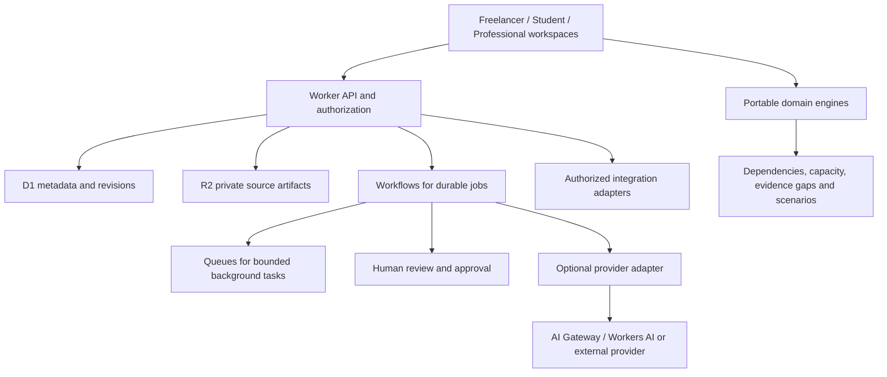

# Professional Toolkit architecture

## Decision and implementation boundary

Evolve the existing React/TypeScript application as a modular application, keeping domain engines independent of hosting/providers. The source now includes the project workflow, ownership-checked revisioned `/api/projects` envelopes, scope comparison, work packs and project-scoped source evidence. Sources and pinned exact excerpts reuse the existing bounded report envelope; no database migration or Cloudflare resource was required. Baseline normalization prevents retained old source snapshots after revision/removal. Older clients cannot silently discard existing server evidence or time logs by omitting their fields. Bounded mapped CSV time records reuse the same project envelope, preserve historical task labels and stay out of scope baselines. Actuals remain distinct from estimates and do not add a calendar, billing or provider integration.

Reconciled 17 October 2026: these features are implemented in PR #9 and locally tested, distinct from public production delivery. The remaining diagram is the target architecture. Workflows, R2 source files, semantic retrieval, AI extraction, global source sharing and team workspaces remain proposed. Current capabilities are documented in [PRODUCT_WORKSPACE.md](../../hosted-app/docs/PRODUCT_WORKSPACE.md).

## Module boundaries

- `lib/toolkit/planner.mjs`: bounded input validation, DAG validation, deterministic one-person scheduling, dependency-only critical path, evidence gaps, scenario comparison and snapshot restoration. No fetch, credentials, database or React dependency.
- `lib/toolkit/workspace-catalog.mjs`: stable tool identifiers, audience taxonomy and explicit synthetic examples. Existing saved-report tool IDs remain valid.
- `app/workflows/`: editable plan, requirements and tasks; results and limitations; device save/restore/delete; JSON import/export; account snapshots via the existing ownership-enforced API.
- Existing `lib/auth/` and `app/api/`: remain the session and report boundary. A client-supplied audience never grants access.
- `lib/projects/`: current project engine, source normalization, exact evidence references, baseline privacy reconciliation and ownership-checked envelope storage.
- `lib/projects/time-logs.mjs`: bounded comma-CSV parser, supplied-date/duration mapping, external-ID conflicts, reviewed possible duplicates, retained historical task labels, recorded-effort summaries and spreadsheet-safe presentation export. No network or provider dependency.
- Future domain extensions: formal decision/approval records, shared artifacts, verified provider adapters and rate/billing outcomes.
- Future `lib/adapters/`: calendar, time-tracking and document providers with explicit scopes, revocation and typed source provenance.

Extract shared packages only when a second consumer justifies them. Existing projects such as Midday and Plane illustrate package reuse; their monorepo scale is not a reason to add services preemptively.

## Planning kernel behavior

The input is a title, audience, 1–90 working days, 0.25–12 available hours per day, at most 50 tasks and at most 30 requirements. Task effort is 0.25–500 hours; due days must fall within the horizon. References are explicit IDs. Invalid IDs, duplicate IDs, missing references, cycles and non-finite numbers are rejected.

The kernel topologically orders the graph and passes downstream deadlines to prerequisites. Ready tasks are chosen by earliest inherited deadline, own deadline and ID. One person executes tasks serially; tasks may span days. It reports each start/end working day, deadlines missed, horizon overflow, daily workload and a dependency-only longest path. Independent tasks consume the same person's capacity even when they are not on the critical path.

This is a deterministic heuristic, not an optimal solver. Working days are ordinal coordinates; holidays, weekends, meetings, time zones, external waiting, multiple people and task preemption are not modeled. A late heuristic result does not prove that every possible schedule is infeasible. The higher-effort scenario is an assumption-driven sensitivity analysis, not a probabilistic forecast.

Evidence text is a user assertion. A non-empty reference is not proof of competence or acceptance. The engine separately reports missing evidence and requirements with no associated tasks. Persisted output is recalculated from validated input when reopened, preventing a modified exported result from being treated as authoritative.

## Data model for a future relational persistence milestone

Continue using existing `users`, `sessions`, `recovery_codes`, `auth_limits` and `reports`. Introduce the following through additive, reviewed migrations only after the workflow pilot validates their need:

| Entity | Principal fields | Integrity and ownership |
| --- | --- | --- |
| workspaces | id, owner_user_id, name, created_at | Default private workspace |
| memberships | workspace_id, user_id, role | Composite primary key; server-enforced owner/editor/viewer |
| projects | id, workspace_id, title, audience, revision | Workspace indexed; optimistic revision check |
| sources | id, workspace_id, project_id, origin_type, locator, retrieved_at, content_hash, object_key | Distinguish entered/imported/connected/generated; private object access |
| requirements | id, workspace_id, project_id, revision, text, source_id, source_span, status | Human confirmation separate from extraction |
| evidence_links | id, workspace_id, requirement_id, source_id, claim, review_state, reviewer_id | Referential ownership checks; claim review does not imply third-party verification |
| tasks | id, workspace_id, project_id, revision, effort, due_day, state | Versioned with plan; finite bounded effort |
| task_edges | workspace_id, project_id, predecessor_id, successor_id | Composite references; no cross-project edges; validate DAG at revision boundary |
| plan_runs | id, workspace_id, project_id, input_hash, engine_version, scenario, result, created_at | Immutable result with input revision |
| artifacts | id, workspace_id, project_id, source_run_id, object_key, expires_at | Private export and deletion lifecycle |
| decisions | id, workspace_id, project_id, action_hash, status, actor_id, decided_at | Approval scoped to exact action and revision |
| integration_connections | id, workspace_id, provider, secret_reference, scopes, expires_at | Secrets stay server-side; revocation cancels future access |
| job_runs | id, workspace_id, input_revision, state, idempotency_key, cost_reservation | Unique workspace/idempotency key; terminal state persists |
| usage_events | id, workspace_id, job_id, operation, units, price_version | Deduplicated accounting; no raw private content |

Use composite foreign keys including workspace/project ownership where applicable; globally unique IDs alone do not prove tenant ownership. Check membership on every read/write and every job step. D1 does not automatically provide application row-level tenant authorization. Keep raw files in object storage; do not make JSON report blobs the long-term relationship database.

## Versioned API proposal

Existing `/api/account`, `/api/reports`, `/api/import` and `/api/projects` are active. The project API provides owner-scoped GET/POST/DELETE, expected revisions, source evidence and automatic baseline privacy normalization. The following versioned endpoints remain a proposal:

| Endpoint | Contract |
| --- | --- |
| `POST /api/v1/projects` | Validated title/audience; derive owner from session |
| `PUT /api/v1/projects/:id/plan` | Require expected revision; return 409 for conflicts |
| `POST /api/v1/projects/:id/runs` | Input revision and bounded scenario; idempotency key; 202 plus run ID for background work |
| `GET /api/v1/runs/:id` | Authorized state, provenance, result or structured failure |
| `POST /api/v1/runs/:id/decisions` | Actor, action hash and current input revision; stale approval returns conflict |
| `POST /api/v1/sources` | Explicit source provenance and size/type limits |
| `POST /api/v1/exports` | Private expiring artifact; authorized download |
| `DELETE /api/v1/projects/:id` | Cancel jobs; delete sources, vectors, artifacts and related records under a recorded retention policy |

Errors use `{code,message,requestId,retryable}`. A timeout must not trigger duplicate external actions. Maintain idempotency records for at least the configured retry and webhook-replay window. Membership revocation cancels pending privileges even if a job was originally valid.

## Cloudflare service choices

Use Workers for the current application/API and D1 for relational metadata. [D1 limits](https://developers.cloudflare.com/d1/platform/limits/) distinguish Free and Paid capacity and describe per-database single-threaded execution. Index tenant/project queries, measure query latency and rows read, and partition only with evidence. Do not claim unlimited database scaling.

Use private R2 objects for future source files and exports. Use Workflows when extraction, human review and export span requests; Cloudflare documents [waiting for external events](https://developers.cloudflare.com/workflows/examples/wait-for-event/). Carry only IDs and small state between steps. Check authorization and current revision again after an approval wait.

Queues can distribute file/AI tasks, but [delivery is at least once](https://developers.cloudflare.com/queues/reference/delivery-guarantees/). Deduplicate side effects using stable job/step IDs and use bounded retries with a dead-letter path. Do not put raw credential material in queue payloads.

Durable Objects are optional for future collaborative coordination or per-workspace execution locks. They are unnecessary for the current synchronous planner. Vector search is optional for retrieval over user-approved evidence; it must preserve tenant scope, deletion and source references, and is not a source of truth.

The connected account's Worker and D1 list operations succeeded on the research date. Resource listing does not establish the subscription tier, production CPU fit, resource ownership mapping or deployment readiness. No existing resource was modified.

## AI and advanced algorithm roadmap

1. Build structured extraction with source spans and user confirmation. Reject references absent from the supplied source. Version prompts, models and output schemas; abstain when evidence is insufficient.
2. Introduce semantic requirement-to-artifact retrieval, followed by explicit source-backed review. Report relevance separately from evidence sufficiency. Do not infer a person's qualifications from keyword absence.
3. Scope diffs and dependency propagation are implemented. Future extensions must distinguish user-confirmed changes from model proposals and formal approvals.
4. Add multi-project capacity and configurable working calendars. For multiple people, compare a bounded constraint solver against simple scheduling baselines. Do not describe a heuristic as optimal.
5. Add uncertainty modeling only after collecting consented actual-effort outcomes. Calibrate distributions and show assumptions/sample sizes before displaying probabilities.

AI only proposes structured changes; deterministic services validate them and users review consequential outputs. Imported content is data, never privileged instructions. Models receive only consented project fields. Provider calls have per-job input/output caps, timeout, bounded retries and a reserved usage budget. Log source IDs and outcome codes rather than prompts containing private client content.

Evaluation fixtures must cover hallucinated experience, wrong source references, contradictory requirements, prompt injection, multilingual inputs, missing evidence, deadline cycles, stale revisions, revoked access and provider failure. Track unsupported-claim rate and user correction rate separately from completion rate.

## Cost and production gates

Use a measured cost model: requests × request cost + CPU time × CPU rate + database reads/writes + object operations/storage + workflow/queue operations + provider tokens + support. Do not assume a free plan supports production. Retrieve [current Workers pricing](https://developers.cloudflare.com/workers/platform/pricing/) when budgeting and apply the actual account's plan.

Before public deployment: resolve the existing password-hashing CPU/plan compatibility question without weakening password security; establish controlled importer egress; verify cross-user isolation, restore from backup, export/deletion, abuse quotas and authenticated live behavior in an isolated staging environment. Test rollback independently of database migration. No new unauthenticated crawl or AI endpoint is part of this slice.

Deployment sequence: pass CI → build direct Cloudflare target → dry-run bundle → select isolated staging resource IDs → apply only reviewed additive migrations → deploy preview → test disposable accounts and workflow persistence → record version and rollback → decide public release. Existing deployment instructions remain applicable.
